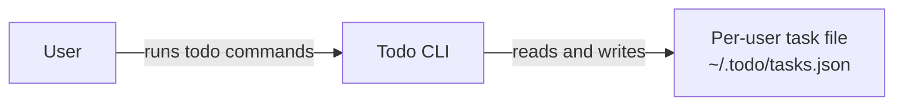

# System specs — overview

The living map of what this system does. Kept current by the archive step of
every implementation change. Investigations never write here.

## Context

## Capabilities
| Capability | What it does | Spec | Diagram |
|------------|--------------|------|---------|
| todo | Manages locally persisted plain-text tasks from the `todo` command. | [spec](todo/spec.md) | Context above |
